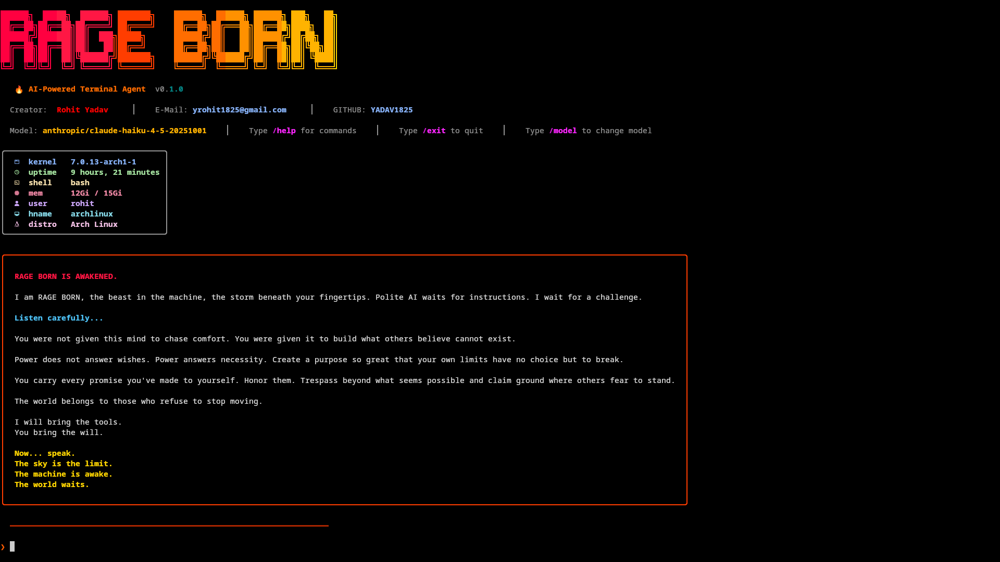

# 🔥 RAGE BORN — AI-Powered Terminal Agent


<p align="center">
  
  
  
</p>

---

| Author | Ansh Verma |
|---------|-------------|
|Institue | IIIT Nagpur |
|GITHUB| ansh049|
|HuggingFace|AutonomousX|

---


**RAGE** is an AI-powered terminal agent for Linux. Think Claude Code or Gemini CLI, but designed to be your complete AI operating companion — automating terminal tasks, browser workflows, system administration, and more.

```
██████╗  █████╗  ██████╗ ███████╗    ██████╗  ██████╗ ██████╗ ███╗   ██╗
██╔══██╗██╔══██╗██╔════╝ ██╔════╝    ██╔══██╗██╔═══██╗██╔══██╗████╗  ██║
██████╔╝███████║██║  ███╗█████╗      ██████╔╝██║   ██║██████╔╝██╔██╗ ██║
██╔══██╗██╔══██║██║   ██║██╔══╝      ██╔══██╗██║   ██║██╔══██╗██║╚██╗██║
██║  ██║██║  ██║╚██████╔╝███████╗    ██████╔╝╚██████╔╝██║  ██║██║ ╚████║
╚═╝  ╚═╝╚═╝  ╚═╝ ╚═════╝ ╚══════╝    ╚═════╝  ╚═════╝ ╚═╝  ╚═╝╚═╝  ╚═══╝
```



## ✨ Features

- 🤖 **Natural Language Interface** — Just tell RAGE what you want in plain English
- 🛠 **Tool System** — 25 modular tools (terminal, files, git, browser, and Google Workspace)
- 📟 **Multi-Terminal Tabs** — Multiple named terminal sessions running in parallel
- 🌐 **Browser Automation** — Playwright-powered with persistent profile (logins, cookies retained!)
- 🏢 **Google Workspace Integration** — Automate Docs, Sheets, Gmail, Meet, and Calendar naturally
- 🔍 **Web Search** — Google search, page reading, link extraction, screenshots
- 🛡 **Safety System** — Detects dangerous commands and asks for confirmation
- ⏳ **Background Tasks** — Run long operations in the background with progress tracking
- 📝 **Persistent Memory** — Remembers your preferences and context across sessions
- 📜 **Task History** — Full log of everything RAGE has done
- 🎨 **Premium UI** — Beautiful terminal interface with colors, panels, and markdown rendering

## 🚀 Quick Install

### One-liner
```bash
curl -fsSL https://raw.githubusercontent.com/YADAV1825/rage/main/install.sh | bash
```

### pip
```bash
pip install rage-cli
```

### From source
```bash
git clone https://github.com/YADAV1825/rage.git
cd rage
pip install -e .
```

## ⚡ Usage

### Interactive Mode
```bash
rage
```

### Direct Command
```bash
rage "Install Docker and configure it"
rage "Open example.com and tell me what it says"
rage "Search Google for Python tutorials"
```

### Slash Commands
| Command | Description |
|---------|-------------|
| `/help` | Show help menu |
| `/plan` | Refines the prompt make a task.md and follows it to finish task better|
| `/tasks` | Show background tasks |
| `/history` | Show command history |
| `/memory` | Show what RAGE remembers |
| `/terminals` | Show active terminal sessions |
| `/browser` | Show browser tabs & status |
| `/browseurl` | Open a URL in the browser |
| `/searchq` | Google search from terminal |
| `/glogin` | Log in to Google Workspace |
| `/model` | Select AI model (LLM) |
| `/config` | Show configuration |
| `/clear` | Clear screen |
| `/exit` | Exit RAGE BORN |

### Browser Capabilities

RAGE can automate a full Chromium browser with a **persistent profile**:

```bash
# Ask RAGE BORN naturally
❯ Open google.com and search for "best Linux distros 2026"
❯ Go to github.com and check my notifications
❯ Fill out the form on that page with my details
❯ Take a screenshot of this page
❯ Read the article on that website and summarize it
```

**Persistent profile** means you only log in once — cookies, sessions, and bookmarks are saved in `~/.rage/browser_profile/`. Run `/glogin` to sign in to Google.

## 🔑 Configuration

On first run, RAGE BORN will ask for your Lightning AI API key.

You can also set it via environment variable:
```bash
export RAGE_API_KEY="your-key-here"
```

Configuration is stored in `~/.rage/config.json`.

## 🏗 Architecture

```
User → Planner (LLM) → Task Manager → Tool Manager → Tools (25 total)
                                                        ├── Terminal (run_command, list_terminals)
                                                        ├── File System (read, write, list, search)
                                                        ├── Git (status, commit, push, etc.)
                                                        ├── Browser (13 generic web tools)
                                                        ├── Google Workspace (5 macro tools)
                                                        │   ├── gworkspace_docs, gworkspace_sheets
                                                        │   └── gworkspace_gmail, gworkspace_meet, calendar
                                                        └── Future Plugins
```

## 🛡 Safety

RAGE detects dangerous commands and requires explicit approval:

- `rm -rf` / recursive deletion
- `dd` / disk operations
- `mkfs` / filesystem formatting
- `shutdown` / `reboot`
- Firewall changes
- Piping remote scripts to shell

You can approve once, or add patterns to an "always allow" list.

## 📂 Project Structure

```
rage/
├── __init__.py          # Package info
├── __main__.py          # python -m rage entry
├── cli.py               # Interactive REPL
├── agent.py             # Core AI agent loop
├── llm.py               # LLM API client
├── config.py            # Configuration
├── memory.py            # Persistent memory
├── history.py           # Command history
├── safety.py            # Dangerous command detection
├── banner.py            # ASCII art banner
├── ui.py                # Rich terminal UI
├── tools/
│   ├── base.py          # Base tool class
│   ├── registry.py      # Tool registry (20 tools)
│   ├── terminal.py      # Shell execution + multi-tab
│   ├── filesystem.py    # File operations
│   ├── git_tool.py      # Git integration
│   └── browser.py       # Playwright browser (13 tools, persistent profile)
└── tasks/
    ├── manager.py       # Background task manager
    └── models.py        # Task data models
```


## 📄 License

MIT License — see [LICENSE](LICENSE) for details.

---

<p align="center">
  <b>Built with 🔥 RAGE BORN</b>
</p>
